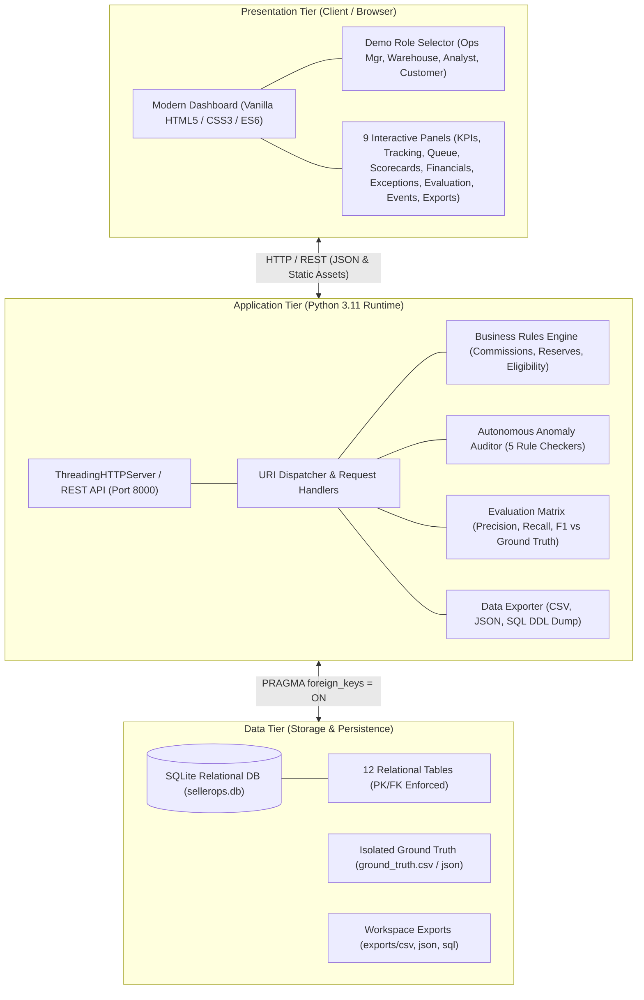

# SellerOps Control Tower — Architecture Overview

## 1. System Philosophy & Design Principles

The **SellerOps Control Tower** is an enterprise-grade marketplace operations intelligence platform designed to monitor seller service levels (SLAs), split multi-seller fulfillment pipelines, govern disputes/chargebacks, compute effective-dated commissions, manage rolling reserve escrows, reconcile payout settlements, and autonomously detect compliance and financial anomalies with zero external dependencies.

### Key Architectural Pillars
1. **Three-Tier Separation:** Strict boundaries between Presentation (interactive UI), Application (REST API, business rules engine, anomaly auditor), and Data (relational database, event history, exports).
2. **Multi-Seller Traceability:** Orders containing products from multiple sellers are transparently partitioned into seller-specific fulfillment items (`FUL-<order-line-id>`), preserving individual carrier tracking, SLA deadlines, and seller payouts.
3. **Auditable Lifecycle History:** Every state mutation produces an immutable event record in `event_logs`, ensuring state changes can be reconstructed and audited.
4. **Isolated Operational Auditing:** The anomaly detection engine operates strictly on transactional data using documented business rules. The ground truth evaluation view operates as a post-hoc benchmark without feeding labels into operational detection logic.
5. **Zero-Dependency Portability:** Built on standard-library Python (with optional FastAPI adapter), SQLite, and vanilla modern HTML5/CSS/JavaScript, running seamlessly on any Windows system.

---

## 2. Three-Tier Architectural Topology

---

## 3. Workflow & Business Rules

### 3.1 Multi-Seller Order Partitioning & Fulfillment
- When a customer purchases multiple items in a single cart (`ORD-2026-XXXXXX`), items can originate from disparate sellers.
- Each item is assigned an immutable line ID (`LINE-2026-XXXXXX-YY`).
- For each order line, a seller-specific fulfillment record is spawned (`FUL-LINE-2026-XXXXXX-YY`).
- Fulfillments progress through a deterministic state machine:
  $$\text{ALLOCATED} \longrightarrow \text{PICKED} \longrightarrow \text{PACKED} \longrightarrow \text{SHIPPED} \longrightarrow \text{DELIVERED} \;(\longrightarrow \text{RETURNED})$$
- SLA compliance is evaluated against carrier dispatch and delivery timestamps:
  - Ship SLA: $\text{shipped\_at} \le \text{order\_date} + 2\text{ days}$
  - Delivery SLA: $\text{delivered\_at} \le \text{shipped\_at} + 4\text{ days}$

### 3.2 Effective-Dated Commissions
Commission rates are resolved dynamically using category and seller tier schedules:
- Look up matching rule where `category IN (item.category, 'ALL')`, `seller_tier IN (seller.tier, 'ALL')`, and $\text{effective\_from} \le \text{order\_date} \le \text{effective\_to}$.
- Fallback category defaults: Electronics (8%), Apparel (15%), Home & Kitchen (12%), Beauty (14%), Books (10%), Sports (11%). Tier 1 and Enterprise merchants receive preferential 1%–2% discount schedules.

### 3.3 Rolling Risk Reserves & Hold Windows
To protect the marketplace against chargebacks and seller defaults:
- **Enterprise:** 4% reserve rate, 7-day hold window post-delivery.
- **Tier 1:** 6% reserve rate, 7-day hold window post-delivery.
- **Tier 2:** 9% reserve rate, 14-day hold window post-delivery.
- **Tier 3:** 12% reserve rate, 21-day hold window post-delivery.
- Funds are locked in escrow until:
  $$\text{Hold Release Date} = \text{delivered\_at} + \text{hold\_period\_days}$$

### 3.4 Payout Settlement & Arithmetic Reconciliation
A payout header (`PAYOUT-2026-XXXXXX`) settles delivered order lines whose hold release date has passed:
$$\text{Net Payout} = \sum \text{Gross Line Subtotal} - \sum \text{Commission} - \sum \text{Reserve Hold} - \sum \text{Upheld Disputes}$$
Every payout contains itemized child records (`payout_lines`):
- `GROSS_SALES`: Positive credit per order line.
- `COMMISSION_FEE`: Negative debit per order line.
- `RESERVE_HOLD`: Negative debit for tier escrow hold.
- `DISPUTE_DEDUCTION`: Negative debit for upheld customer chargebacks.
Strict reconciliation enforces that $\text{payout.net\_amount} = \sum \text{payout\_lines.amount}$.

---

## 4. Autonomous Anomaly Detection Engine

The rules engine audits database records autonomously without accessing ground truth:

| Anomaly Class | Rule Identifier | Detection Logic | Financial Impact |
| :--- | :--- | :--- | :--- |
| **Premature Payout** | `Rule FIN-01` | Payout released or approved prior to fulfillment delivery or before $\text{hold\_release\_date}$. | Entire net payout amount at risk. |
| **Double Commission** | `Rule FIN-02` | Order line incurred multiple `COMMISSION_FEE` deductions or doubled commission rate. | Overbilled commission fee. |
| **Suspended Seller Trading** | `Rule SEC-01` | Merchant with status `SUSPENDED` maintains `ACTIVE` product listings or receives new orders. | Potential fraudulent GMV. |
| **Undeducted Dispute** | `Rule DISP-01` | Order line had an `UPHELD` dispute, but payout settled without deducting dispute amount. | Unrecovered chargeback amount. |
| **Payout Total Mismatch**| `Rule REC-01` | Discrepancy between payout header `net_amount` and mathematical sum of constituent `payout_lines`. | Reconciliation variance ($). |

---

## 5. Actor Role Capabilities

The application includes a prominent demo role selector supporting 4 operational perspectives:

1. **Operations Manager:**
   - Full governance over marketplace financial settlement.
   - Payout approval, freeze/hold actions, dispute resolution.
   - Exception queue triage with drill-down into evidence and recommended remediation.
2. **Warehouse Operator:**
   - Real-time fulfillment queue filtered by status and carrier.
   - One-click workflow advancement (Pick $\rightarrow$ Pack $\rightarrow$ Ship $\rightarrow$ Deliver).
   - SLA deadline warnings and late-dispatch flags.
3. **Performance Analyst:**
   - Seller scorecards, tier distribution, GMV, and commission yield.
   - SLA on-time shipment % and delivery % metrics.
   - Dispute rate tracking and return frequency analysis.
4. **Customer:**
   - Multi-seller order tracking by Order ID.
   - Breakdown of packages by merchant with carrier tracking numbers.
   - Verified review browser and star ratings.
