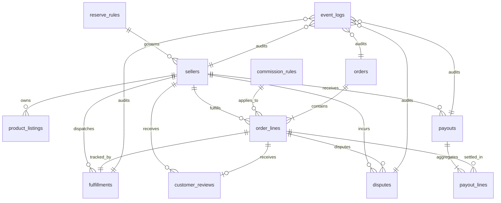

# SellerOps Control Tower — Schema & Data Dictionary

This document specifies the relational data model, entity relationships, validation rules, lifecycle state machines, and data dictionary for the **SellerOps Control Tower** system.

---

## 1. Entity-Relationship Overview

---

## 2. Core Entities & Data Dictionary

### 2.1 Table: `sellers`
Represents independent merchant entities operating on the marketplace platform.

| Field Name | Type | Required? | Allowed Values / Format | Units | Unique? | Validation Rules & Constraints |
| :--- | :--- | :--- | :--- | :--- | :--- | :--- |
| `seller_id` | `TEXT` | Yes | `SELL-000001` to `SELL-999999` | None | Yes (PK) | Strict regex `^SELL-\d{6}$`. Immutable zero-padded ID. |
| `name` | `TEXT` | Yes | Non-empty string | None | No | Length between 2 and 100 characters. |
| `email` | `TEXT` | Yes | Valid email format | None | No | RFC 5322 compliant email string. |
| `tier` | `TEXT` | Yes | `TIER_1`, `TIER_2`, `TIER_3`, `ENTERPRISE` | None | No | Check constraint: must be one of allowed tier enums. |
| `status` | `TEXT` | Yes | `ACTIVE`, `PROBATION`, `SUSPENDED` | None | No | Check constraint. Suspended sellers cannot take new orders or maintain active listings. |
| `onboarding_date` | `TEXT` | Yes | `YYYY-MM-DD` | Calendar Date | No | ISO-8601 calendar date. Must be $\le$ current date. |
| `reserve_rate` | `REAL` | Yes | $0.00$ to $0.50$ | Decimal (0% - 50%) | No | Check constraint: `reserve_rate >= 0.0 AND reserve_rate <= 0.5`. Default derived from tier. |
| `hold_period_days`| `INTEGER` | Yes | $\ge 0$ | Days | No | Check constraint: `hold_period_days >= 0`. Typical: 7, 14, 21, or 30 days. |

- **Primary Key:** `seller_id`
- **Foreign Keys:** None
- **Lifecycle States:** `ACTIVE` $\rightarrow$ `PROBATION` $\rightarrow$ `SUSPENDED` (or reinstated to `ACTIVE`).

---

### 2.2 Table: `product_listings`
Products published by sellers to the marketplace storefront.

| Field Name | Type | Required? | Allowed Values / Format | Units | Unique? | Validation Rules & Constraints |
| :--- | :--- | :--- | :--- | :--- | :--- | :--- |
| `listing_id` | `TEXT` | Yes | `LIST-<seller-id>-000001` | None | Yes (PK) | Strict format: `^LIST-SELL-\d{6}-\d{6}$`. |
| `seller_id` | `TEXT` | Yes | Valid `sellers.seller_id` | None | No | Foreign Key referencing `sellers(seller_id)`. |
| `title` | `TEXT` | Yes | Non-empty string | None | No | Length between 3 and 255 characters. |
| `category` | `TEXT` | Yes | `Electronics`, `Apparel`, `Home & Kitchen`, `Beauty`, `Books`, `Sports` | None | No | Check constraint against allowed product categories. |
| `price` | `REAL` | Yes | $> 0.00$ | USD ($) | No | Check constraint: `price > 0`. |
| `inventory_count` | `INTEGER` | Yes | $\ge 0$ | Units | No | Check constraint: `inventory_count >= 0`. |
| `status` | `TEXT` | Yes | `ACTIVE`, `PAUSED`, `ARCHIVED` | None | No | Check constraint. If seller is `SUSPENDED`, status must be `ARCHIVED` (Rule SEC-01). |
| `created_at` | `TEXT` | Yes | `YYYY-MM-DD HH:MM:SS` | Timestamp | No | ISO-8601 UTC timestamp. |

- **Primary Key:** `listing_id`
- **Foreign Keys:** `seller_id` $\rightarrow$ `sellers.seller_id`
- **Cardinality:** 1 Seller to Many Product Listings ($1:N$).

---

### 2.3 Table: `commission_rules`
Effective-dated commission rate schedules determined by product category and seller tier.

| Field Name | Type | Required? | Allowed Values / Format | Units | Unique? | Validation Rules & Constraints |
| :--- | :--- | :--- | :--- | :--- | :--- | :--- |
| `rule_id` | `TEXT` | Yes | `RULE-000001` to `RULE-999999` | None | Yes (PK) | Strict regex `^RULE-\d{6}$`. |
| `category` | `TEXT` | Yes | Allowed category or `ALL` | None | No | Category matching rule selector. |
| `seller_tier` | `TEXT` | Yes | Allowed tier or `ALL` | None | No | Seller tier selector. |
| `rate` | `REAL` | Yes | $0.00$ to $1.00$ | Decimal (0% - 100%)| No | Check constraint: `rate >= 0.0 AND rate <= 1.0`. |
| `effective_from` | `TEXT` | Yes | `YYYY-MM-DD` | Calendar Date | No | Check constraint: `effective_from <= effective_to`. |
| `effective_to` | `TEXT` | Yes | `YYYY-MM-DD` | Calendar Date | No | Upper bound of validity period. |
| `description` | `TEXT` | No | Free text | None | No | Human-readable audit description. |

- **Primary Key:** `rule_id`

---

### 2.4 Table: `reserve_rules`
Policy defining default rolling escrow holds by seller tier.

| Field Name | Type | Required? | Allowed Values / Format | Units | Unique? | Validation Rules & Constraints |
| :--- | :--- | :--- | :--- | :--- | :--- | :--- |
| `reserve_rule_id`| `TEXT` | Yes | `RES-000001` to `RES-999999` | None | Yes (PK) | Strict regex `^RES-\d{6}$`. |
| `seller_tier` | `TEXT` | Yes | `TIER_1`, `TIER_2`, `TIER_3`, `ENTERPRISE` | None | No | Enum check constraint. |
| `default_reserve_rate` | `REAL` | Yes | $0.00$ to $1.00$ | Decimal | No | Check constraint: `default_reserve_rate >= 0.0 AND <= 1.0`. |
| `hold_period_days`| `INTEGER` | Yes | $\ge 0$ | Days | No | Check constraint: `hold_period_days >= 0`. |
| `effective_from` | `TEXT` | Yes | `YYYY-MM-DD` | Calendar Date | No | Start date of policy. |
| `effective_to` | `TEXT` | Yes | `YYYY-MM-DD` | Calendar Date | No | End date of policy. |

- **Primary Key:** `reserve_rule_id`

---

### 2.5 Table: `orders`
Customer transaction headers containing one or more order lines across multiple sellers.

| Field Name | Type | Required? | Allowed Values / Format | Units | Unique? | Validation Rules & Constraints |
| :--- | :--- | :--- | :--- | :--- | :--- | :--- |
| `order_id` | `TEXT` | Yes | `ORD-2026-000001` | None | Yes (PK) | Strict regex `^ORD-\d{4}-\d{6}$`. |
| `customer_id` | `TEXT` | Yes | `CUST-00001` to `CUST-99999` | None | No | Customer identifier. |
| `order_date` | `TEXT` | Yes | `YYYY-MM-DD HH:MM:SS` | Timestamp | No | Timestamp when order was placed. |
| `total_amount` | `REAL` | Yes | $\ge 0.00$ | USD ($) | No | Check constraint: `total_amount >= 0`. Must equal sum of child `order_lines.subtotal`. |
| `status` | `TEXT` | Yes | `PENDING`, `PROCESSING`, `PARTIALLY_FULFILLED`, `DELIVERED`, `COMPLETED`, `CANCELLED` | None | No | Enum check constraint. |
| `shipping_address`| `TEXT` | Yes | Non-empty address string | None | No | Physical destination address. |

- **Primary Key:** `order_id`
- **Cardinality:** 1 Order to Many Order Lines ($1:N$).

---

### 2.6 Table: `order_lines`
Individual product items within an order, tied to specific sellers.

| Field Name | Type | Required? | Allowed Values / Format | Units | Unique? | Validation Rules & Constraints |
| :--- | :--- | :--- | :--- | :--- | :--- | :--- |
| `order_line_id` | `TEXT` | Yes | `LINE-2026-000001-01` | None | Yes (PK) | Format: `LINE-<order-id-suffix>-<line-seq>`. |
| `order_id` | `TEXT` | Yes | Valid `orders.order_id` | None | No | FK referencing `orders(order_id)`. |
| `listing_id` | `TEXT` | Yes | Valid `product_listings.listing_id` | None | No | FK referencing `product_listings(listing_id)`. |
| `seller_id` | `TEXT` | Yes | Valid `sellers.seller_id` | None | No | FK referencing `sellers(seller_id)`. |
| `quantity` | `INTEGER` | Yes | $> 0$ | Units | No | Check constraint: `quantity > 0`. |
| `unit_price` | `REAL` | Yes | $> 0.00$ | USD ($) | No | Check constraint: `unit_price > 0`. |
| `subtotal` | `REAL` | Yes | $\ge 0.00$ | USD ($) | No | Must equal `quantity * unit_price`. |
| `commission_rate`| `REAL` | Yes | $0.00$ to $1.00$ | Decimal | No | Rate retrieved from `commission_rules`. |
| `commission_amount`| `REAL`| Yes | $\ge 0.00$ | USD ($) | No | Must equal `subtotal * commission_rate`. Overcharged if duplicated (Rule FIN-02). |

- **Primary Key:** `order_line_id`
- **Foreign Keys:**
  - `order_id` $\rightarrow$ `orders.order_id`
  - `listing_id` $\rightarrow$ `product_listings.listing_id`
  - `seller_id` $\rightarrow$ `sellers.seller_id`
- **Cardinality:** $1:1$ with `fulfillments`.

---

### 2.7 Table: `fulfillments`
Seller-specific package fulfillment records. Multi-seller orders split into line-specific fulfillments.

| Field Name | Type | Required? | Allowed Values / Format | Units | Unique? | Validation Rules & Constraints |
| :--- | :--- | :--- | :--- | :--- | :--- | :--- |
| `fulfillment_id`| `TEXT` | Yes | `FUL-<order-line-id>` | None | Yes (PK) | Exact format: `^FUL-LINE-\d{4}-\d{6}-\d{2}$`. |
| `order_line_id` | `TEXT` | Yes | Valid `order_lines.order_line_id` | None | Yes | Unique FK referencing `order_lines(order_line_id)`. |
| `order_id` | `TEXT` | Yes | Valid `orders.order_id` | None | No | FK referencing `orders(order_id)`. |
| `seller_id` | `TEXT` | Yes | Valid `sellers.seller_id` | None | No | FK referencing `sellers(seller_id)`. |
| `status` | `TEXT` | Yes | `ALLOCATED`, `PICKED`, `PACKED`, `SHIPPED`, `DELIVERED`, `RETURNED`, `FAILED` | None | No | Enum check constraint. |
| `carrier` | `TEXT` | Yes | `FedEx`, `UPS`, `DHL`, `USPS` | None | No | Enum check constraint. |
| `tracking_number`| `TEXT` | Yes | `TRK-\d{9}` | None | No | Carrier tracking identifier. |
| `sla_ship_deadline` | `TEXT` | Yes | `YYYY-MM-DD HH:MM:SS` | Timestamp | No | Expected ship deadline (order_date + 2 days). |
| `shipped_at` | `TEXT` | No | `YYYY-MM-DD HH:MM:SS` | Timestamp | No | Required if status $\in$ (`SHIPPED`, `DELIVERED`). Must be $\ge$ `order_date`. |
| `sla_delivery_deadline` | `TEXT` | Yes | `YYYY-MM-DD HH:MM:SS` | Timestamp | No | Expected delivery deadline (shipped_at + 4 days). |
| `delivered_at` | `TEXT` | No | `YYYY-MM-DD HH:MM:SS` | Timestamp | No | Required if status is `DELIVERED`. Must be $\ge$ `shipped_at`. |
| `returned_at` | `TEXT` | No | `YYYY-MM-DD HH:MM:SS` | Timestamp | No | Required if status is `RETURNED`. Must be $\ge$ `delivered_at`. |
| `is_late_shipment` | `INTEGER` | Yes | `0` or `1` | Boolean | No | Derived: 1 if `shipped_at > sla_ship_deadline`, else 0. |
| `is_late_delivery` | `INTEGER` | Yes | `0` or `1` | Boolean | No | Derived: 1 if `delivered_at > sla_delivery_deadline`, else 0. |

- **Primary Key:** `fulfillment_id`
- **Foreign Keys:**
  - `order_line_id` $\rightarrow$ `order_lines.order_line_id`
  - `order_id` $\rightarrow$ `orders.order_id`
  - `seller_id` $\rightarrow$ `sellers.seller_id`
- **Lifecycle States:** `ALLOCATED` $\rightarrow$ `PICKED` $\rightarrow$ `PACKED` $\rightarrow$ `SHIPPED` $\rightarrow$ `DELIVERED` ($\rightarrow$ `RETURNED`).

---

### 2.8 Table: `customer_reviews`
Verified buyer feedback linked to delivered fulfillment lines.

| Field Name | Type | Required? | Allowed Values / Format | Units | Unique? | Validation Rules & Constraints |
| :--- | :--- | :--- | :--- | :--- | :--- | :--- |
| `review_id` | `TEXT` | Yes | `REV-2026-000001` | None | Yes (PK) | Strict regex `^REV-\d{4}-\d{6}$`. |
| `order_id` | `TEXT` | Yes | Valid `orders.order_id` | None | No | FK referencing `orders(order_id)`. |
| `order_line_id` | `TEXT` | Yes | Valid `order_lines.order_line_id` | None | No | FK referencing `order_lines(order_line_id)`. |
| `seller_id` | `TEXT` | Yes | Valid `sellers.seller_id` | None | No | FK referencing `sellers(seller_id)`. |
| `listing_id` | `TEXT` | Yes | Valid `product_listings.listing_id` | None | No | FK referencing `product_listings(listing_id)`. |
| `rating` | `INTEGER` | Yes | `1`, `2`, `3`, `4`, `5` | Stars | No | Check constraint: `rating >= 1 AND rating <= 5`. |
| `title` | `TEXT` | Yes | String | None | No | Review summary headline. |
| `comment` | `TEXT` | Yes | String | None | No | Detailed customer feedback. |
| `created_at` | `TEXT` | Yes | `YYYY-MM-DD HH:MM:SS` | Timestamp | No | Timestamp of submission. Must be $\ge$ `delivered_at`. |

---

### 2.9 Table: `disputes`
Chargebacks, claims, and buyer complaints lodged against order lines.

| Field Name | Type | Required? | Allowed Values / Format | Units | Unique? | Validation Rules & Constraints |
| :--- | :--- | :--- | :--- | :--- | :--- | :--- |
| `dispute_id` | `TEXT` | Yes | `DSP-2026-000001` | None | Yes (PK) | Strict regex `^DSP-\d{4}-\d{6}$`. |
| `order_id` | `TEXT` | Yes | Valid `orders.order_id` | None | No | FK referencing `orders(order_id)`. |
| `order_line_id` | `TEXT` | Yes | Valid `order_lines.order_line_id` | None | No | FK referencing `order_lines(order_line_id)`. |
| `seller_id` | `TEXT` | Yes | Valid `sellers.seller_id` | None | No | FK referencing `sellers(seller_id)`. |
| `amount` | `REAL` | Yes | $> 0.00$ | USD ($) | No | Check constraint: `amount > 0`. Cannot exceed line subtotal. |
| `reason` | `TEXT` | Yes | `ITEM_NOT_RECEIVED`, `ITEM_DEFECTIVE`, `INCORRECT_ITEM`, `UNAUTHORIZED_CHARGE`, `LATE_DELIVERY` | None | No | Enum check constraint. |
| `status` | `TEXT` | Yes | `OPEN`, `UNDER_REVIEW`, `UPHELD`, `REJECTED`, `RESOLVED` | None | No | Enum check constraint. |
| `opened_at` | `TEXT` | Yes | `YYYY-MM-DD HH:MM:SS` | Timestamp | No | ISO-8601 UTC timestamp. |
| `resolved_at` | `TEXT` | No | `YYYY-MM-DD HH:MM:SS` | Timestamp | No | Nullable until dispute reaches terminal state. |
| `deducted_from_payout` | `INTEGER`| Yes | `0` or `1` | Boolean | No | 1 if withheld from seller payout. Anomaly if UPHELD but 0 (Rule DISP-01). |

---

### 2.10 Table: `payouts`
Consolidated settlement statements disbursing net payable funds to sellers.

| Field Name | Type | Required? | Allowed Values / Format | Units | Unique? | Validation Rules & Constraints |
| :--- | :--- | :--- | :--- | :--- | :--- | :--- |
| `payout_id` | `TEXT` | Yes | `PAYOUT-2026-000001` | None | Yes (PK) | Strict regex `^PAYOUT-\d{4}-\d{6}$`. |
| `seller_id` | `TEXT` | Yes | Valid `sellers.seller_id` | None | No | FK referencing `sellers(seller_id)`. |
| `period_start` | `TEXT` | Yes | `YYYY-MM-DD` | Date | No | Start date of settlement accounting cycle. |
| `period_end` | `TEXT` | Yes | `YYYY-MM-DD` | Date | No | End date of cycle. `period_start <= period_end`. |
| `gross_amount` | `REAL` | Yes | $\ge 0.00$ | USD ($) | No | Sum of settled item line revenues. |
| `commission_deduction`| `REAL`| Yes | $\ge 0.00$ | USD ($) | No | Total commission withheld by platform. |
| `reserve_deduction` | `REAL` | Yes | $\ge 0.00$ | USD ($) | No | Total reserve held in rolling escrow. |
| `dispute_deduction` | `REAL` | Yes | $\ge 0.00$ | USD ($) | No | Total chargeback debits for upheld claims. |
| `net_amount` | `REAL` | Yes | Any float | USD ($) | No | Formula: `gross - commission - reserve - dispute`. Must match sum of child `payout_lines.amount` (Rule REC-01). |
| `status` | `TEXT` | Yes | `DRAFT`, `PENDING_APPROVAL`, `APPROVED`, `PROCESSING`, `PAID`, `HELD` | None | No | Enum check constraint. |
| `created_at` | `TEXT` | Yes | `YYYY-MM-DD HH:MM:SS` | Timestamp | No | Statement generation timestamp. |
| `hold_release_date`| `TEXT` | Yes | `YYYY-MM-DD` | Date | No | Earliest legal release date (`delivery_date + hold_period_days`). |
| `released_at` | `TEXT` | No | `YYYY-MM-DD HH:MM:SS` | Timestamp | No | Actual disbursement timestamp. Anomaly if `released_at < hold_release_date` (Rule FIN-01). |

- **Primary Key:** `payout_id`
- **Cardinality:** 1 Payout to Many Payout Lines ($1:N$).

---

### 2.11 Table: `payout_lines`
Itemized constituent debits and credits composing each payout header.

| Field Name | Type | Required? | Allowed Values / Format | Units | Unique? | Validation Rules & Constraints |
| :--- | :--- | :--- | :--- | :--- | :--- | :--- |
| `payout_line_id`| `TEXT` | Yes | `PAYLINE-2026-000001-01` | None | Yes (PK) | Strict format: `^PAYLINE-\d{4}-\d{6}-\d{2}$`. |
| `payout_id` | `TEXT` | Yes | Valid `payouts.payout_id` | None | No | FK referencing `payouts(payout_id)`. |
| `order_line_id` | `TEXT` | Yes | Valid `order_lines.order_line_id` | None | No | FK referencing `order_lines(order_line_id)`. |
| `line_type` | `TEXT` | Yes | `GROSS_SALES`, `COMMISSION_FEE`, `RESERVE_HOLD`, `DISPUTE_DEDUCTION` | None | No | Enum check constraint. |
| `amount` | `REAL` | Yes | Signed Float | USD ($) | No | Positive for `GROSS_SALES`; negative for deductions. |
| `description` | `TEXT` | No | String | None | No | Human-readable explanation. |

---

### 2.12 Table: `event_logs`
Traceable audit trail capturing all state transitions, warehouse updates, and payout approvals.

| Field Name | Type | Required? | Allowed Values / Format | Units | Unique? | Validation Rules & Constraints |
| :--- | :--- | :--- | :--- | :--- | :--- | :--- |
| `event_id` | `TEXT` | Yes | `EVT-2026-000001` | None | Yes (PK) | Strict regex `^EVT-\d{4}-\d{6}$`. |
| `entity_type` | `TEXT` | Yes | `SELLER`, `ORDER`, `FULFILLMENT`, `DISPUTE`, `PAYOUT`, `EXCEPTION` | None | No | Entity category under audit. |
| `entity_id` | `TEXT` | Yes | Valid referenced Entity ID | None | No | Identifier of the changed record. |
| `event_type` | `TEXT` | Yes | E.g. `STATUS_CHANGE`, `SHIPMENT_DISPATCHED`, `DELIVERY_CONFIRMED`, `PAYOUT_SETTLED` | None | No | Event transition action name. |
| `old_state` | `TEXT` | No | String / Null | None | No | State prior to event (null for creation). |
| `new_state` | `TEXT` | No | String | None | No | State after event. |
| `payload_json` | `TEXT` | No | JSON String | None | No | Serialized context payload. |
| `actor` | `TEXT` | Yes | `SYSTEM`, `WAREHOUSE_OPERATOR`, `CUSTOMER`, `OPS_MANAGER`, `DISPUTE_AGENT` | None | No | Enum check constraint. |
| `created_at` | `TEXT` | Yes | `YYYY-MM-DD HH:MM:SS` | Timestamp | No | Immutable UTC timestamp of event occurrence. |
